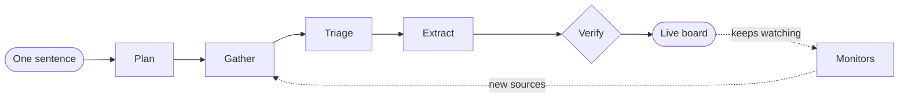

<div align="center">


# Faraday

**One sentence in, a live situation board out.**

[](https://faraday.watch)

[](https://context.dev)
[](LICENSE)

[Try it](https://faraday.watch) &nbsp;|&nbsp; [How it works](#how-it-works) &nbsp;|&nbsp; [Run locally](#run-locally)

</div>

---

When a flood, fire, blackout or cyberattack hits, the facts are scattered across hundreds of pages that change by the minute. Describe the crisis in one sentence. Faraday reads the live web through [Context.dev](https://context.dev), builds a situation board, and keeps it current on its own.

Every figure on the board links to the source it came from.

> Built at Junction 2026 for the Context.dev challenge, "The Web Is Your Real-Time Database".

## How it works

The sentence is the program. The board is what it compiles to.



| Step | What happens |
| :- | :- |
| **Plan** | An LLM turns the sentence into a plan: crisis type, place, search queries, the questions the board must answer, and what counts as a change. |
| **Gather** | Context.dev news and web search run in parallel, with optional X recent search for local signals. The best web pages are scraped in full; social posts already contain their text. |
| **Triage** | Each source is checked against this specific crisis. Off-topic results are dropped. |
| **Extract** | Facts are pulled out as structured data, each with a verbatim quote from its source. |
| **Verify** | Plain code checks that every quote really exists in the source text. No quote, no fact. |
| **Watch** | Context.dev monitors and a news poller feed new sources back in. The board updates and logs what changed. |

Three rules keep the board honest:

- **No model fills in a widget.** Stats, tables, timelines and the map are assembled from verified facts by pure functions. The written summary may only cite those facts.
- **No model invents a location.** Coordinates come from a geocoder, never from an LLM.
- **Every edit is a program edit.** In the studio, "add a table of road closures" patches the plan and recompiles the board.

Boards are also agent-ready: each one registers its controls as WebMCP tools.

## Context.dev at the core

| API | Used for |
| :- | :- |
| `news.search` | Recent articles for each query, filtered by date |
| `web.search` | Official advisories, shelters and status pages, with highlights |
| `web.scrape` | Full Markdown of the pages worth reading closely |
| `monitors` | Semantic change detection every 10 minutes on a search and on official pages |
| Webhook `change.detected` | Triggers an update the moment a monitor fires |

## Architecture

| Host | Runs on | What |
| :- | :- | :- |
| `faraday.watch` | Vercel | Landing, Google sign-in and the studio |
| `api.faraday.watch` | Vultr | Engine API, SSE streams, webhooks and the background worker |
| `<slug>.faraday.watch` | Vultr | Every published board, with its own HTTPS certificate |

```
client/    Next.js 16 app: site, studio, board hosting
server/    Hono API, worker, pipeline graphs, MariaDB
scripts/   provision, deploy, Caddyfile, systemd units
```

## Run locally

Put your keys in a single `.env` at the root, point `DATABASE_URL` at a MariaDB, then:

```bash
cd server && npm install && npm run dev   # http://localhost:4000, migrates on start
cd client && npm install && npm run dev   # http://localhost:3000
```

X is optional. Set `X_API_BEARER_TOKEN` in the same root `.env` to enable it for newly planned boards. Existing plans without `socialQueries` continue without X. Background X polling runs only for hot boards.

`X_BOARD_DAILY_READ_LIMIT` defaults to 20 and `X_GLOBAL_DAILY_READ_LIMIT` defaults to 100. Each request reserves 10 reads before calling X, including on errors or empty results; counters reset at midnight UTC. Set either limit to 0 to stop live X reads. Invalid limits also stop reads. Reservations and per-board/query `since_id` cursors persist in MariaDB (migration 006). Queries combine up to two local keyword/hashtag searches, exclude retweets, and request one page of 10 posts without retries or pagination. A cursor advances after source ingestion succeeds; this deliberately samples the newest posts rather than backfilling a busy search.

Social quotes pass the same quote/number checks as other facts, but appear only in **On the ground (unverified)**. Official/news confirmation must be extracted and verified independently before the information enters figures, tables, timelines, maps, status, advisories or summaries. Social reports cannot overwrite trusted facts or supply numbers to the change log. See [implementation and validation](docs/x-social-source.md).

Leave `FARADAY_DOMAIN` empty locally and boards are served at `/b/<slug>`.

Deploy with `scripts/deploy.sh` (engine and boards) and `scripts/deploy-site.sh` (main site).

## Stack

| Layer | Tech |
| :- | :- |
| Web | Next.js 16, React 19, Tailwind 4, SW3 UI (`@sw3/ui`, our design system, pinned in `client/vendor`) |
| Engine | Hono, AI SDK 7, MariaDB, Server-Sent Events |
| Models | Gemini 4 Hydrogen and Carbon, with OpenAI as a switchable fallback |
| Data | Context.dev TypeScript SDK, MapLibre with OpenFreeMap tiles |
| Infra | Vercel, Vultr, Caddy with on-demand TLS |

## License

[MIT](LICENSE)
